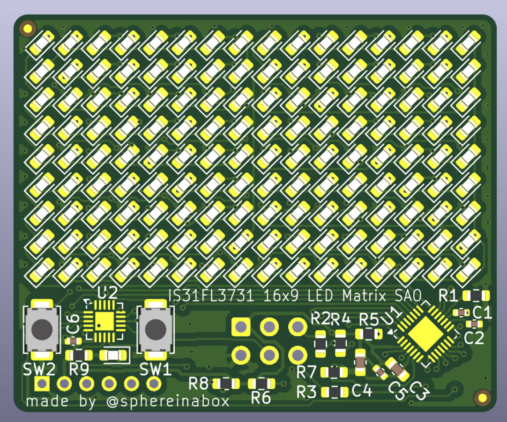
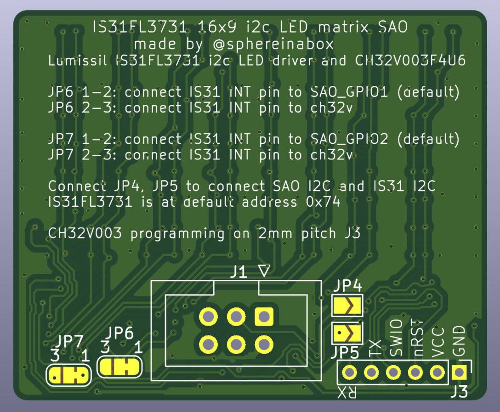

# Sixteen-Nine SAO 2026
SAO with 16x9 LED matrix

Uses ISSI IS31FL3731 i2c to 16x9 charlieplex LED matrix driver, and WCH CH32V003 microcontroller.

By defaul the SAO i2c connections go to ch32v003, but can be changed with solder jumpers to connect the LED matrix driver i2c to SAO i2c directly.

## Included Animations
 * Bounce: Kind of like bouncing DVD logo animation
 * Plasma
 * Scrolling text
 * Conways Game of Life

## Hardware

[Schematic PDF](kicad/v1/schematic.pdf)

This SAO has:
 1. 16x9 LED matrix
 2. IS31FL3731 I2C LED Driver
 3. CH32V003 QFN20
 4. 2 Push-buttons
 5. One more LED

 The SAO I2C connection goes to the ch32v003 microcontroller, which then has other pins to talk to the IS31 LED driver.

### Back Side

### Jumpers JP4, JP5
Connect the SAO I2C to the IS31 LED driver directly by briding the JP4/JP5

### Jumpers JP6, JP7
JP6 selects which pins are connected to the IS31_INT pin
 - 1-2 bridged (default) SAO GPIO1 connects to IS31_INT
 - 2-3 bridged, connect ch32v003 pin `PA1` to IS31_INT

JP7 selects wich pins are connected to IS31_IN analog input pin for audio-reactive animations
 - 1-2 bridged (default) SAO GPIO2 connects to IS31_IN
 - 2-3 bridged, connect ch32v003 pin `PA2` to IS31_IN

## Ch32V003 software

Uses ch32fun: https://github.com/cnlohr/ch32fun

See [Software Readme](software/ch32/README.md) for more

